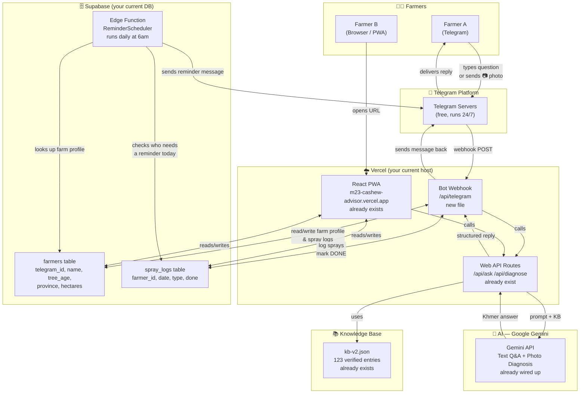
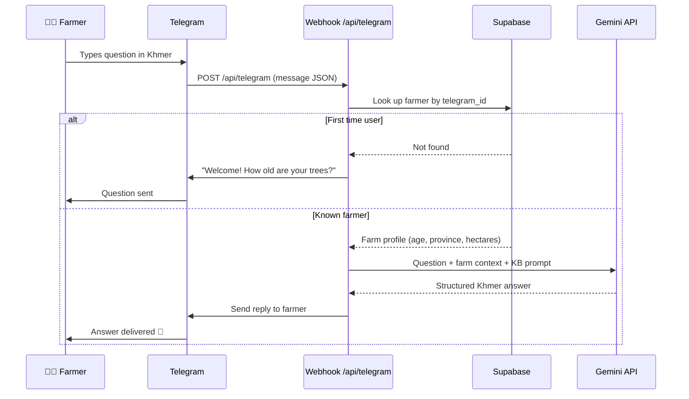
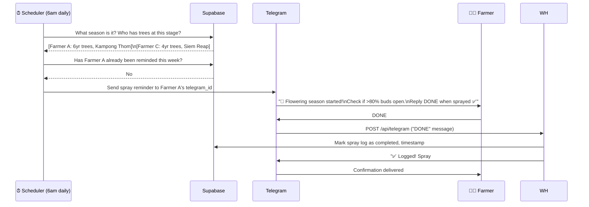
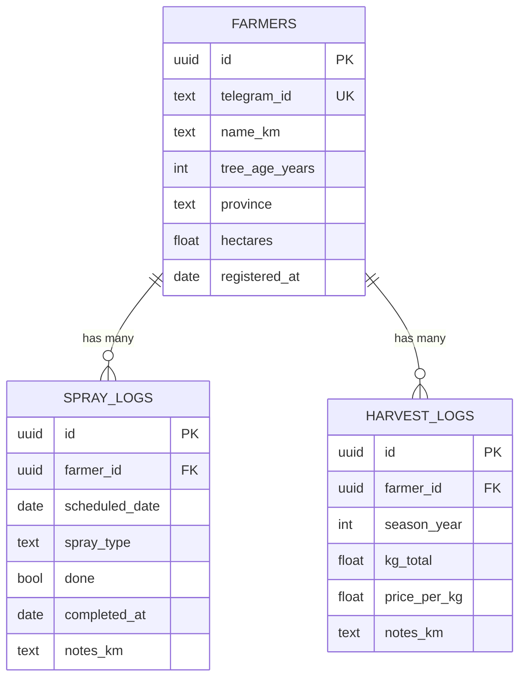
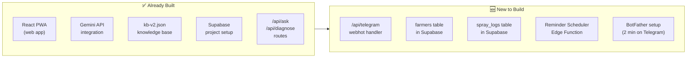
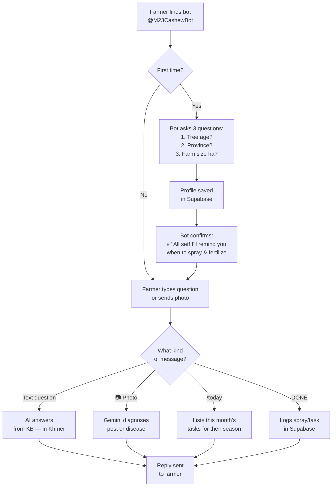

# System Architecture — M23 Cashew Advisor + Telegram Bot

---

## Big Picture — How Everything Connects

---

## Zoom In — What Happens When a Farmer Messages the Bot

---

## Zoom In — How Reminders Work

---

## Data Model — What Gets Stored in Supabase

---

## What's New vs. What Already Exists

> [!NOTE]
> The new pieces **reuse** all your existing logic. The webhook just calls `/api/ask` and `/api/diagnose` the same way the web app does — it's a new *front door*, not a new brain.

---

## Farmer Journey — First Time vs. Returning

---

## Summary — One Line per Layer

| Layer | What it is | Status |
|---|---|---|
| **Telegram** | Delivery channel — free, runs itself | 🆕 Register bot (2 min) |
| **`/api/telegram`** | Webhook — receives messages, routes them | 🆕 ~100 lines of code |
| **`/api/ask` `/api/diagnose`** | AI routes — unchanged | ✅ Already done |
| **Gemini API** | AI brain — unchanged | ✅ Already done |
| **`kb-v2.json`** | Knowledge source — unchanged | ✅ Already done |
| **Supabase DB** | Stores farmer profiles + spray logs | 🆕 2 new tables |
| **Reminder Scheduler** | Daily Edge Function — sends proactive messages | 🆕 ~50 lines of code |
| **React PWA** | Full web app — unchanged | ✅ Already done |
