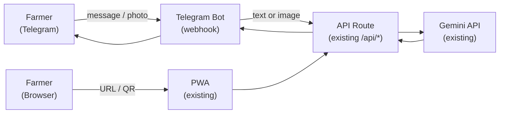

# Coach Feedback Response — Pivot Strategy

> [!IMPORTANT]
> **Coach's feedback:** Getting cashew farmers to download and use a new app is a real barrier. Suggestion: pivot to **Telegram** or connect features to a **web app** instead.

---

## Reading the Feedback Correctly

The coach is raising an **adoption/distribution** problem, not a product problem. The features (Khmer Q&A, photo diagnosis, spray journal, seasonal tasks) are solid — the barrier is the app-install friction, not the content.

The good news: **you already have a web app.** The current build is a PWA deployed at `m23-cashew-advisor.vercel.app`. The coach's "web app" suggestion is already done. The real question is whether you lean into that more explicitly *and/or* add a Telegram bot as a zero-friction entry point.

---

## Option Comparison

| | **Web app (current PWA)** | **Telegram Bot** | **Both (recommended)** |
|---|---|---|---|
| Farmer install required? | No — just a URL | No — Telegram already installed | No |
| Works on basic Android? | Yes | Yes | Yes |
| Photo diagnosis | ✅ Full support | ✅ `/diagnose` + photo upload | ✅ |
| Khmer Q&A | ✅ Chat UI | ✅ Free-text messages | ✅ |
| Spray journal / farm data | ✅ Full UI | ⚠️ Basic (text commands only) | ✅ Rich on web, light on Telegram |
| Offline use | ✅ PWA with SW | ❌ Requires data | ✅ Covered by web fallback |
| Distribution | Shared URL / QR code | Bot username / QR code | Both channels |
| Build effort (remaining days) | Low — already exists | Medium — new Deno/Python bot service | Medium |

---

## Recommended Pivot: "Web-first + Telegram as the front door"

Don't throw away the existing React PWA. Instead:

1. **Reframe the web app as the product** (not a "PWA you need to install")
   - Emphasise "open in browser, no install needed" — remove or de-emphasise the Install button from the hero experience
   - Add a prominent shareable QR code on the landing/welcome screen for field workers to hand out

2. **Add a Telegram bot for zero-friction first contact**
   - The bot handles the two highest-value, most shareable features: **text Q&A** and **photo diagnosis**
   - A farmer doesn't need to open a browser — they message the bot in a group they're already in
   - The bot can reply with a link to the full web app for spray journal / farm passport features

3. **Shared backend** — both the web app and the Telegram bot call the same Gemini/Claude API route, so the knowledge base stays one source of truth

---

## What the Telegram Bot Would Look Like

```
Farmer texts: "ដំណាំខ្ញុំមានស្លឹកលឿង"  (My leaves are turning yellow)
Bot replies:   [Khmer answer from KB] + short English gloss

Farmer sends:  📷 [photo of diseased leaf]
Bot replies:   Diagnosis card (matched pest/disease, treatment steps in Khmer)

Farmer texts: /today
Bot replies:   This month's tasks for the current season
```

Commands to build for v1:
| Command | Maps to |
|---|---|
| Any free text | `askAdvisor()` → Khmer Q&A |
| Photo message | `diagnosePhoto()` → pest/disease ID |
| `/today` | `currentMonth()` tasks list |
| `/help` | Feature list + web app link |

---

## Build Plan (if you pursue Telegram)



**New files needed:**
- `telegram-bot/index.ts` — Deno/Node webhook handler (Telegram Bot API)
- Deploy alongside the existing Vercel functions, or as a separate lightweight service

**Existing files reused as-is:**
- `api/` — all current API routes
- `knowledge-base/kb-v2.json` — no changes
- `supabase/functions/cashew-advisor/` — same Edge Function
- All React components — untouched

**Estimated effort:** 1–2 days for a working Telegram bot with text Q&A + photo diagnosis

---

## What to Tell the Coach

> "You're right on adoption — we've addressed it two ways. The current build is already a web app (no install required, just a URL), and we're adding a Telegram bot as a zero-friction entry point for farmers who are already on Telegram. Both channels call the same backend, so the knowledge base and AI are consistent. The web app handles the richer features (spray journal, farm passport); the bot handles instant Q&A and photo diagnosis in the channel they already use."

---

## Decision Needed from You

> [!NOTE]
> The web app reframe is essentially free — it's a messaging and UI copy change.
> The Telegram bot is a real build task. Given the hackathon timeline, do you want to:

- **A)** Just reframe the web app messaging + add QR code (low effort, addresses the feedback)
- **B)** Build the Telegram bot as the new primary demo (medium effort, stronger story)
- **C)** Both — web app is the product, Telegram bot is the headline feature for the pitch

